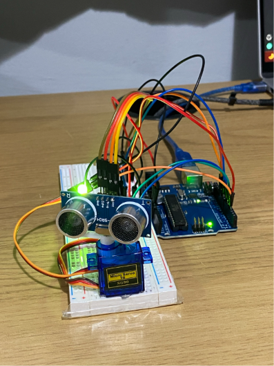
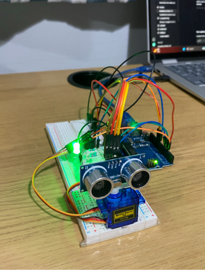
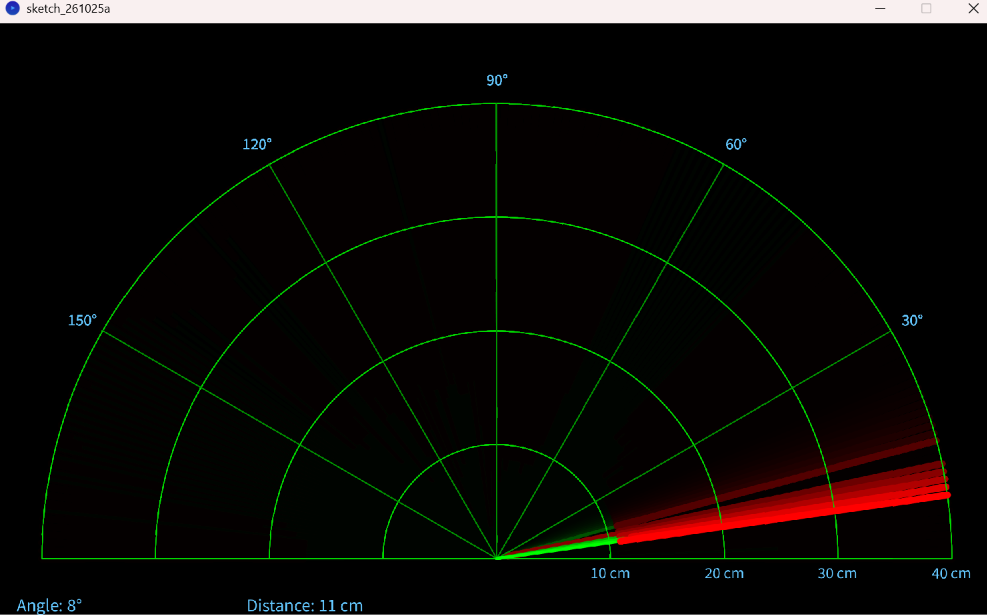

# Arduino Sonar Scanner

A tabletop sonar-style scanner built with an Arduino Uno, an HC-SR04 ultrasonic sensor, and a micro servo. The Arduino sweeps the sensor through 180 degrees, reports each angle and distance over serial, and changes an RGB LED and buzzer as objects get closer. A Processing sketch turns the readings into a live radar display.



## How it works

1. The servo sweeps from 0° to 180° and back again.
2. At every degree, the Arduino sends a short trigger pulse to the ultrasonic sensor.
3. The echo duration is converted to centimetres with `distance = duration × 0.017`.
4. The Arduino sends `angle,distance.` over USB serial at 9600 baud.
5. Processing reads each period-terminated measurement and plots it on a 40 cm semicircular display.
6. The RGB LED and buzzer give a local warning even when Processing is not running.

## Parts

- Arduino Uno or compatible 5 V board
- HC-SR04 ultrasonic distance sensor
- SG90 micro servo
- RGB LED
- Three 220–330 Ω resistors, one for each LED channel
- Passive piezo buzzer
- Breadboard and jumper wires
- USB cable
- Computer with the Arduino IDE and Processing 4

## Wiring

Disconnect USB power before changing any wiring. Connect every module to a common ground.

| Component | Connection | Arduino pin |
| --- | --- | --- |
| Servo signal | Orange/yellow signal lead | D3 |
| Servo power | Red lead | 5 V |
| Servo ground | Brown/black lead | GND |
| HC-SR04 VCC | Power | 5 V |
| HC-SR04 GND | Ground | GND |
| HC-SR04 TRIG | Trigger | D10 |
| HC-SR04 ECHO | Echo | D11 |
| Buzzer positive | Signal | D9 |
| Buzzer negative | Ground | GND |
| RGB LED red channel | Through a 220–330 Ω resistor | D4 |
| RGB LED green channel | Through a 220–330 Ω resistor | D5 |
| RGB LED blue channel | Through a 220–330 Ω resistor | D6 |
| RGB LED common cathode | Ground | GND |

The supplied sketch assumes a **common-cathode** RGB LED, so `HIGH` turns a colour on. If yours is common-anode, connect its common leg to 5 V and invert the LED output levels in the sketch.

> A small servo can cause resets or jitter when powered from the Uno. If that happens, use a regulated external 5 V supply for the servo and connect the supply ground to Arduino GND. Do not power the servo from Vin.



## Distance warnings

| Measured distance | LED | Buzzer |
| --- | --- | --- |
| More than 40 cm | Green | Off |
| 11–40 cm | Yellow (red + green) | 100 Hz |
| 10 cm or less | Red | 500 Hz |

The Processing display is scaled to 40 cm. Readings beyond that range are still sent, but are not drawn as detected objects.

## Serial protocol

Each reading has this format:

```text
angle,distance.
```

For example, `90,23.` means an object was measured 23 cm away while the servo was at 90°. Values are whole numbers in the serial message, the comma separates fields, and the period terminates a reading. Processing uses the period rather than the newline as its message delimiter, so readings work in both sweep directions.

## Run the project

### 1. Upload the Arduino sketch

1. Open [`arduino/sonar-scanner.ino`](arduino/sonar-scanner.ino) in the Arduino IDE.
2. Select the correct board and port.
3. Upload the sketch.
4. Optionally open Serial Monitor at **9600 baud** to confirm readings such as `90,23.`.
5. Close Serial Monitor before starting Processing; only one program can use the serial port at a time.

### 2. Start the radar display

1. Open [`processing/SonarRadar/SonarRadar.pde`](processing/SonarRadar/SonarRadar.pde) in Processing 4.
2. Run it once and check the port list printed in the Processing console.
3. Set `SERIAL_PORT_INDEX` near the top of the sketch to the number beside the Arduino port.
4. Run the sketch again.

The window should show the current angle and distance, a green sweep line, and red returns for objects within 40 cm.



## Troubleshooting

| Problem | What to check |
| --- | --- |
| Processing says the port index is invalid | Read the numbered list in the Processing console, update `SERIAL_PORT_INDEX`, and reconnect the Arduino if no ports appear. |
| Port is busy or access is denied | Close Arduino Serial Monitor, Serial Plotter, and any other program using the port. |
| Radar opens but does not update | Confirm both sketches use 9600 baud and that the Arduino output follows `angle,distance.`. |
| Distance is always 0 or erratic | Recheck TRIG on D10 and ECHO on D11, share GND, and make sure the sensor faces away from nearby wires. |
| Servo jitters or the Arduino resets | Use a separate regulated 5 V servo supply with common ground and keep power leads short. |
| Servo moves in the wrong direction | This is harmless; swap the screen mapping in Processing or mount the sensor in the opposite orientation. |
| LED colours are reversed or always on | Check the RGB pin order and whether the LED is common-cathode or common-anode. Use a resistor on every colour channel. |
| Measurements jump near soft or angled objects | Ultrasonic sound can be absorbed or reflected away. Test first with a large, flat, hard target. |

## What I learned

This build combines several parts that have to stay coordinated: servo movement, ultrasonic timing, visual and sound warnings, and serial communication with a desktop program. It also shows why a clear data format matters—the comma separates the two values while the period lets Processing recognise a complete reading.

## Possible LiDAR upgrade

A time-of-flight LiDAR sensor could replace the HC-SR04 for a narrower beam, steadier readings on small targets, and potentially a longer useful range. A future version could use a sensor such as the VL53L1X over I²C, update the distance calculation and range scale, and keep the same angle-and-distance serial interface so the Processing display needs only small changes.

## Attribution

Built while following a [Robonyx classroom lesson](https://www.skool.com/robonyx/classroom/de13e21c?md=161261021dbe44c4831718968e1f5147). The Arduino and Processing sketches are based on the code supplied during the build and are included here as a record of the project. The photographs and radar screenshot in this folder are the builder's original images; no AI-generated imagery is used.

No licence is asserted for tutorial-derived code. Check the creator's terms before redistributing or relicensing it.
